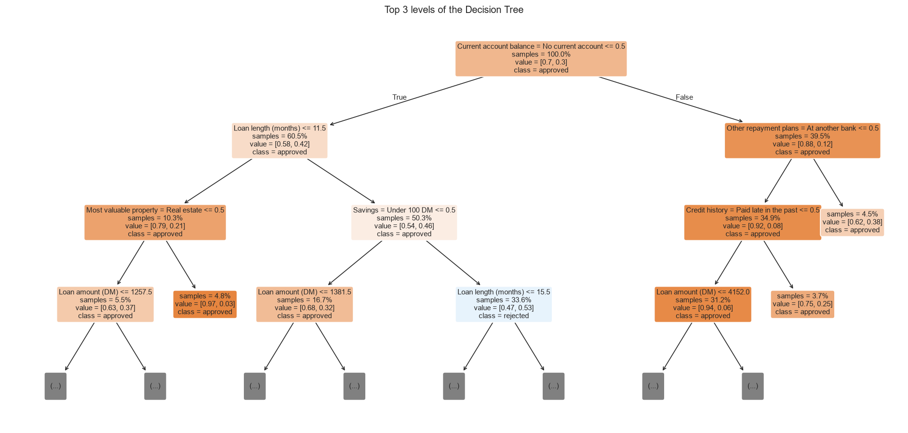

<div align="center">

<h1>Loan approval</h1>

<p>Predicts whether a loan application is approved with a Decision Tree, and shows the rules it learned. Built on the Statlog German Credit data, with an interactive demo that explains every decision as a list of questions.</p>

<p>
<a href="https://github.com/pxnz3r/loan-approval/actions/workflows/ci.yml"></a>

<a href="LICENSE"></a>
</p>

<p><a href="docs/results.md">Results</a> · <a href="docs/methodology.md">Methodology</a> · <a href="docs/deploy.md">Deploy the demo</a></p>



</div>

## How it works

1. **Load and check** 1,000 real credit applications from the German Credit data.
2. **Tune** a Decision Tree and a Random Forest with cross-validation inside leak-free pipelines.
3. **Test how sure the scores are** with bootstrap intervals, a paired test against every rival, learning curves and a baseline that ignores the inputs.
4. **Pick the cut-off** on out-of-fold probabilities at the lowest cost, using the dataset's own cost of 5 for approving a bad loan against 1 for refusing a good one, and check calibration.
5. **Study the mistakes** and **try it** in the Streamlit demo, which uses the tuned cut-off.

## Results

Test set: 250 of the 1,000 applicants (stratified), never used for tuning or model choice. 70% of applicants were approved.

| Model | Accuracy | Balanced accuracy | ROC-AUC | Recall (approved) |
| --- | --- | --- | --- | --- |
| **Decision Tree** (depth 6, 22 leaves) | 0.700 | 0.607 | 0.682 | 0.840 |
| Random Forest (benchmark) | 0.744 | 0.749 | 0.785 | 0.737 |
| Always approve (baseline) | 0.700 | 0.500 | 0.500 | 1.000 |

- **Current account balance dominates.** Shuffling it drops the tree's ROC-AUC by 0.12; the next input, loan length, by 0.03.
- **The rules make sense.** No current account, or a positive balance, leads towards approval; long loans to applicants with under 100 DM in savings lead towards rejection. All 64 lines are in [outputs/loans/tree_rules.txt](outputs/loans/tree_rules.txt).
- **Readability costs accuracy.** The tree matches "always approve" on plain accuracy but separates the classes better (balanced accuracy 0.61 against 0.50). The forest is clearly stronger and can't be read. On this small dataset, depths 2 to 4 test about as well as the chosen depth 6 (see the depth sweep).

Full tables and figures: [docs/results.md](docs/results.md). How it was done: [docs/methodology.md](docs/methodology.md).

## How sure the results are

**The score has a wide margin.** Random Forest's test ROC-AUC is 0.785, with a 95% bootstrap interval of 0.722 to 0.842. With 250 test applicants, that is as precise as it gets.

**The forest is not clearly better than the tree.** On right or wrong answers, McNemar's test gives p = 0.207: the gap could be chance. It does not clearly beat always approving either (p = 0.325), because 70% of applicants are approved anyway.

**The forest overfits.** Training ROC-AUC 0.944 against 0.790 on validation, and its learning curve has levelled off: more data alone would help little.

**The cut-off moves to 0.64.** Approving a bad loan costs 5 times more than refusing a good one, so the demo approves only when the forest is at least 64% sure.

**Recalibration makes the chances honest.** Brier score 0.186 falls to 0.164 after sigmoid recalibration.

**Large loans get missed.** Approved applicants the model refused asked for 3,392 DM on average, against 2,641 for those it caught.

Every table and figure behind these is in [docs/results.md](docs/results.md).

## Run it

Needs Python 3.14+ and [uv](https://docs.astral.sh/uv/).

```bash
uv sync
uv run python main.py
uv run streamlit run app.py
```

`main.py` downloads the data once into `data/`, then writes figures, tables and the tree's rules to `outputs/`, models to `models/` and the tables to `docs/results.md`. Outputs and models are committed, so the demo works without running it.

## The demo

- **Overview**: what the project is, how a Decision Tree decides and what was found.
- **Decide**: fill in an application or start from a real test applicant, and see the decision, the approval score and the questions the tree asked.
- **Rules**: the full rule list, the top of the tree, and how depth trades underfitting for overfitting.
- **Results**: model comparison, ROC curves, mistakes, permutation importance and data checks.

## Inputs

The brief asks for income, credit history and loan amount. Credit history and loan amount (with loan length) are used directly. The data has no income column, so the repayment share of disposable income, current account and savings balances, years in the job and job type stand in for it. Also used: purpose, housing, property, co-applicant or guarantor, other repayment plans and existing loans.

Sex and marital status, age and foreign-worker status are in the data but left out on purpose: lenders may not decide on them, and a readable model would turn them straight into rules.

## Layout

```
loan_approval/   spec.py (inputs and models), data.py (download, readable values), report.py
pxlab/           shared engine (vendored): data checks, pipelines, tuning, evaluation, tree rules, app helpers
main.py          the full study
app.py           the Streamlit demo
docs/            methodology, results, deploy
```

## Data

Hofmann (1994), [Statlog (German Credit Data)](https://archive.ics.uci.edu/dataset/144/statlog+german+credit+data), UCI Machine Learning Repository, CC BY 4.0, via [OpenML 31](https://www.openml.org/d/31). Amounts are in Deutsche Mark.

## License

MIT
