# Results

Produced by `python main.py`. The test set is 25% of the applicants, stratified, and was not used for tuning or model choice. The full rules of the tree are in `outputs/loans/tree_rules.txt`.

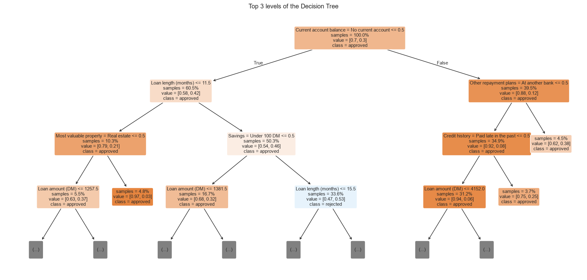

## Models

### Test-set scores

| Model | Role | CV roc auc | Accuracy | Balanced accuracy | Precision | Recall | F1 | ROC-AUC |
| --- | --- | --- | --- | --- | --- | --- | --- | --- |
| Decision Tree | Main | 0.772 | 0.7 | 0.607 | 0.758 | 0.84 | 0.797 | 0.682 |
| Random Forest | Benchmark beyond the course | 0.789 | 0.744 | 0.749 | 0.878 | 0.737 | 0.801 | 0.785 |
| Always approve | Baseline | 0.5 | 0.7 | 0.5 | 0.7 | 1.0 | 0.824 | 0.5 |

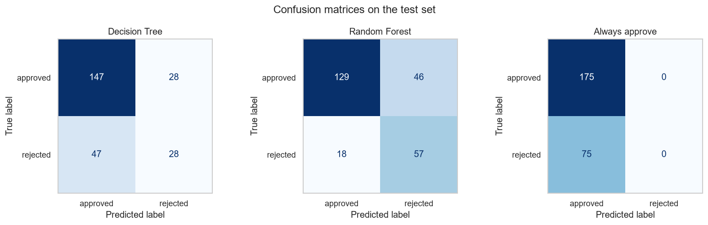

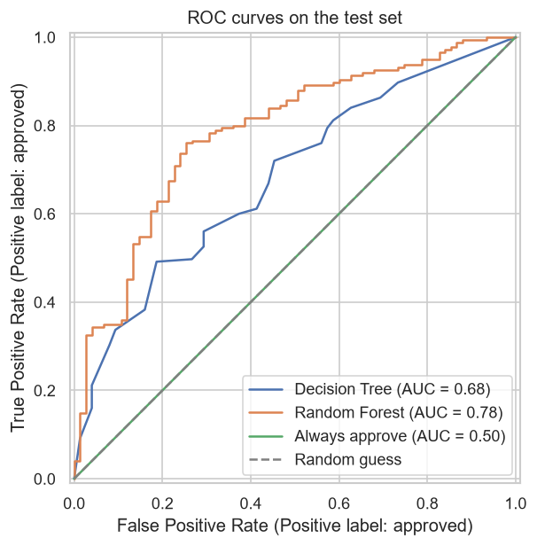

## Key findings

### What the in-depth analysis found

| Finding |
| --- |
| Random Forest scores ROC-AUC 0.785 on the test set (95% interval 0.722 to 0.842); the baseline that ignores the inputs (Always approve) scores 0.500. |
| Random Forest against Decision Tree on right or wrong answers (McNemar): could be chance (p = 0.207). |
| Random Forest against Always approve on right or wrong answers (McNemar): could be chance (p = 0.325). |
| Decision Tree generalises well: training and validation roc auc are close (+0.062); validation is still rising, so more data would likely help. |
| Random Forest overfits: training roc auc 0.944 against validation 0.790; validation has levelled off, so more data alone would help little. |
| Cut-off for Random Forest: 0.64 instead of 0.5, chosen for the lowest cost. On the test set: recall 0.74 to 0.51, precision 0.88 to 0.90, cost per 100 cases 54.4 to 54.4. |
| Most honest probabilities: Random Forest recalibrated (sigmoid) (Brier 0.164); Random Forest has Brier 0.186 and calibration error 0.141. |
| The input that most separates caught from missed approved is Loan amount (DM): average 2,641 when caught, 3,392 when missed. |
| When Random Forest is at least 90% sure it is right 100% of the time (2% of test cases). |

## Reliability

Bootstrap 95% intervals: how much each test score could move with a different test sample.

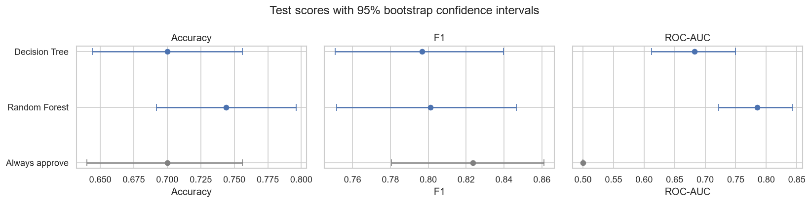

### Confidence intervals

| Model | Score | Test value | Low | High |
| --- | --- | --- | --- | --- |
| Decision Tree | Accuracy | 0.7 | 0.644 | 0.756 |
| Decision Tree | F1 | 0.7967 | 0.7507 | 0.8397 |
| Decision Tree | ROC-AUC | 0.6822 | 0.6121 | 0.7494 |
| Random Forest | Accuracy | 0.744 | 0.6919 | 0.796 |
| Random Forest | F1 | 0.8012 | 0.7515 | 0.8464 |
| Random Forest | ROC-AUC | 0.785 | 0.7219 | 0.8422 |
| Always approve | Accuracy | 0.7 | 0.64 | 0.7561 |
| Always approve | F1 | 0.8235 | 0.7805 | 0.8611 |
| Always approve | ROC-AUC | 0.5 | 0.5 | 0.5 |

### Is the best model really better? (paired tests)

| Best model | Compared with | Best is better on | Other is better on | Test | p-value | Verdict |
| --- | --- | --- | --- | --- | --- | --- |
| Random Forest | Decision Tree | 37 | 26 | McNemar | 0.2074 | Could be chance |
| Random Forest | Always approve | 57 | 46 | McNemar | 0.3245 | Could be chance |

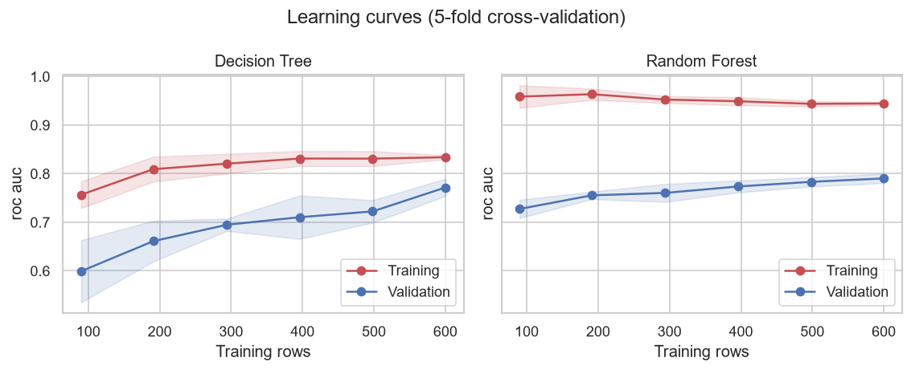

### Learning curves

| Model | Training rows | Training score | Validation score |
| --- | --- | --- | --- |
| Decision Tree | 90 | 0.7567 | 0.5993 |
| Decision Tree | 191 | 0.8092 | 0.6611 |
| Decision Tree | 294 | 0.8206 | 0.6948 |
| Decision Tree | 396 | 0.8311 | 0.7104 |
| Decision Tree | 498 | 0.831 | 0.7223 |
| Decision Tree | 600 | 0.8338 | 0.7715 |
| Random Forest | 90 | 0.9586 | 0.7274 |
| Random Forest | 191 | 0.9635 | 0.7554 |
| Random Forest | 294 | 0.9525 | 0.7604 |
| Random Forest | 396 | 0.949 | 0.7736 |
| Random Forest | 498 | 0.9437 | 0.7832 |
| Random Forest | 600 | 0.9444 | 0.7902 |

## Cut-off and calibration

The cut-off is chosen on cross-validated training predictions, then checked on the test set. Costs: a false alarm costs 5, a miss costs 1. These are the dataset's own costs: lending to someone who doesn't repay loses the money, turning away a good borrower only loses the interest.

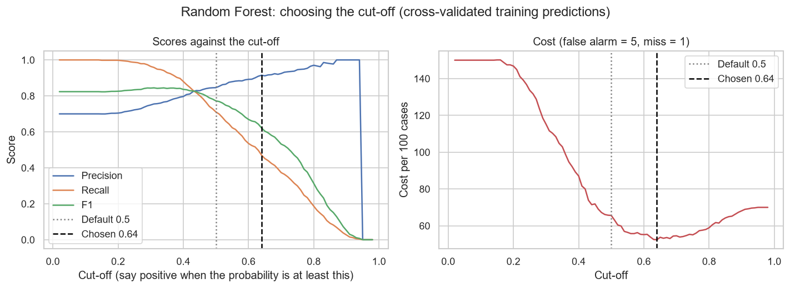

### Default against tuned cut-off on the test set

| Model | Cut-off | Threshold | Precision | Recall | F1 | Accuracy | Cost per 100 cases | TP | FP | FN | TN |
| --- | --- | --- | --- | --- | --- | --- | --- | --- | --- | --- | --- |
| Decision Tree | Default | 0.5 | 0.758 | 0.84 | 0.797 | 0.7 | 105.2 | 147 | 47 | 28 | 28 |
| Decision Tree | Tuned | 0.91 | 0.848 | 0.383 | 0.528 | 0.52 | 67.2 | 67 | 12 | 108 | 63 |
| Random Forest | Default | 0.5 | 0.878 | 0.737 | 0.801 | 0.744 | 54.4 | 129 | 18 | 46 | 57 |
| Random Forest | Tuned | 0.64 | 0.899 | 0.509 | 0.65 | 0.616 | 54.4 | 89 | 10 | 86 | 65 |
| Always approve | Default | 0.5 | 0.7 | 1.0 | 0.824 | 0.7 | 150.0 | 175 | 75 | 0 | 0 |
| Always approve | Tuned | 0.02 | 0.7 | 1.0 | 0.824 | 0.7 | 150.0 | 175 | 75 | 0 | 0 |

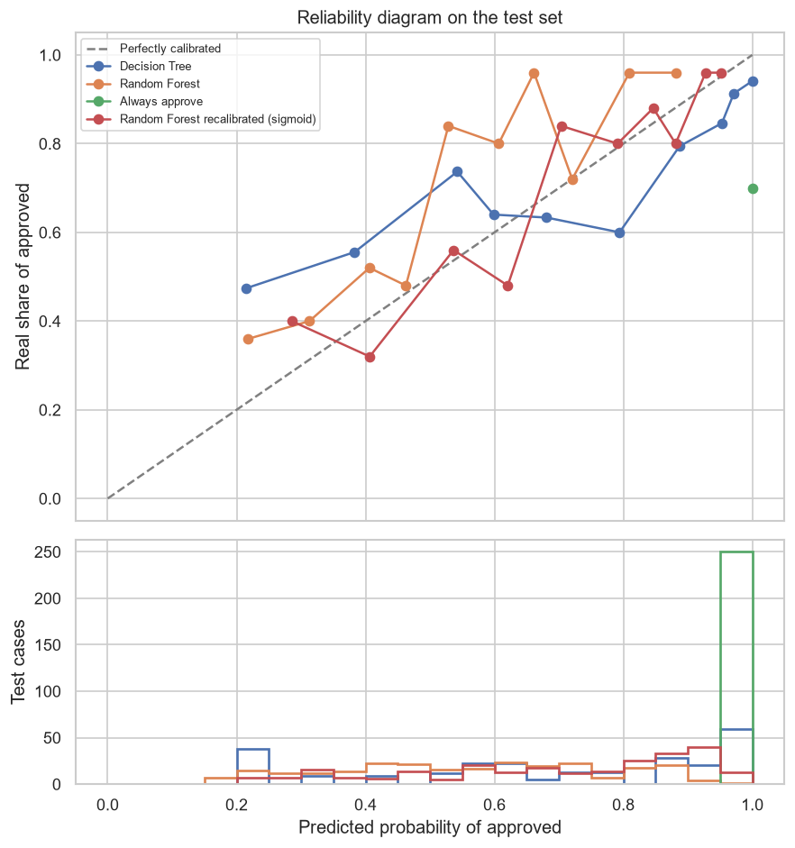

### How honest the probabilities are

| Model | Brier score | Calibration error | Mean predicted | Real positive share |
| --- | --- | --- | --- | --- |
| Decision Tree | 0.2148 | 0.1338 | 0.6835 | 0.7 |
| Random Forest | 0.1857 | 0.1409 | 0.5608 | 0.7 |
| Always approve | 0.3 | 0.3 | 1.0 | 0.7 |
| Random Forest recalibrated (sigmoid) | 0.1643 | 0.0428 | 0.695 | 0.7 |

## Error analysis

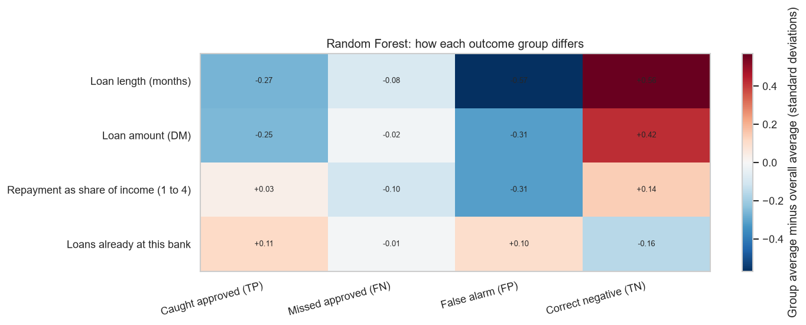

### Average inputs per outcome group

| Input | Caught approved (TP) | Missed approved (FN) | False alarm (FP) | Correct negative (TN) |
| --- | --- | --- | --- | --- |
| Cases | 89.0 | 86.0 | 10.0 | 65.0 |
| Loan length (months) | 17.831 | 20.128 | 14.0 | 28.338 |
| Loan amount (DM) | 2640.697 | 3391.791 | 2452.4 | 4771.569 |
| Repayment as share of income (1 to 4) | 3.079 | 2.93 | 2.7 | 3.2 |
| Loans already at this bank | 1.506 | 1.43 | 1.5 | 1.338 |

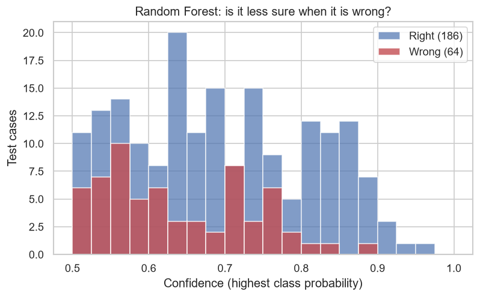

### Accuracy by confidence

| Confidence | Cases | Share of the test set | Accuracy |
| --- | --- | --- | --- |
| 0% to 60% | 76 | 0.304 | 0.632 |
| 60% to 70% | 68 | 0.272 | 0.794 |
| 70% to 80% | 56 | 0.224 | 0.661 |
| 80% to 90% | 45 | 0.18 | 0.933 |
| 90% to 100% | 5 | 0.02 | 1.0 |

## Tree depth

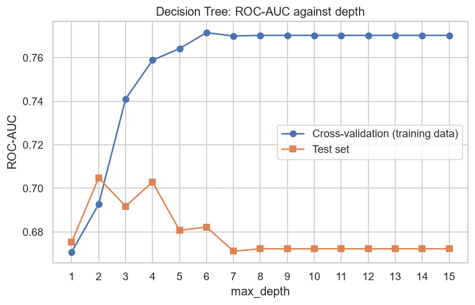

### ROC-AUC against tree depth

| max_depth | CV score | Test score |
| --- | --- | --- |
| 1 | 0.6708 | 0.6752 |
| 2 | 0.6927 | 0.7048 |
| 3 | 0.741 | 0.6918 |
| 4 | 0.7589 | 0.7029 |
| 5 | 0.7642 | 0.6806 |
| 6 | 0.7715 | 0.6822 |
| 7 | 0.7699 | 0.6712 |
| 8 | 0.7702 | 0.6722 |
| 9 | 0.7702 | 0.6722 |
| 10 | 0.7702 | 0.6722 |
| 11 | 0.7702 | 0.6722 |
| 12 | 0.7702 | 0.6722 |
| 13 | 0.7702 | 0.6722 |
| 14 | 0.7702 | 0.6722 |
| 15 | 0.7702 | 0.6722 |

## Which inputs matter

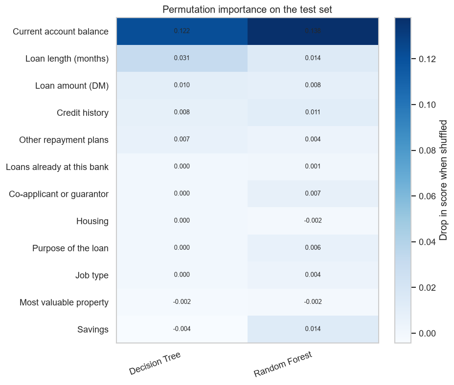

### Permutation importance (drop in ROC-AUC when the input is shuffled)

|  | Decision Tree | Random Forest |
| --- | --- | --- |
| Current account balance | 0.1216 | 0.138 |
| Loan length (months) | 0.0311 | 0.0145 |
| Loan amount (DM) | 0.0101 | 0.0083 |
| Credit history | 0.0076 | 0.0112 |
| Other repayment plans | 0.0068 | 0.0036 |
| Loans already at this bank | 0.0 | 0.0006 |
| Co-applicant or guarantor | 0.0 | 0.0071 |
| Housing | 0.0 | -0.0017 |
| Purpose of the loan | 0.0 | 0.0063 |
| Job type | 0.0 | 0.0039 |
| Most valuable property | -0.0021 | -0.0017 |
| Savings | -0.0042 | 0.0135 |
| Repayment as share of income (1 to 4) | -0.0065 | 0.0006 |
| Years in current job | -0.0156 | -0.0009 |

## Mistakes

### Test applicants the Decision Tree got wrong

| credit_amount | duration | installment_commitment | existing_credits | checking_status | savings_status | credit_history | employment | job | purpose | housing | property_magnitude | other_parties | other_payment_plans | Real | Predicted |
| --- | --- | --- | --- | --- | --- | --- | --- | --- | --- | --- | --- | --- | --- | --- | --- |
| 5152 | 24 | 4 | 1 | 200 DM or more | Under 100 DM | Current loans repaid on time so far | 4 to 7 years | Skilled | Radio/tv | Owns | Car or other | nan | At another bank | approved | rejected |
| 2570 | 27 | 3 | 1 | No current account | Under 100 DM | Current loans repaid on time so far | 1 to 4 years | Skilled | New car | Rents | Real estate | nan | nan | rejected | approved |
| 3857 | 30 | 4 | 1 | Overdrawn | Under 100 DM | Current loans repaid on time so far | 1 to 4 years | Highly qualified, self-employed or manager | Used car | Owns | Savings or life insurance | nan | nan | approved | rejected |
| 1282 | 12 | 2 | 1 | Overdrawn | Under 100 DM | Current loans repaid on time so far | 1 to 4 years | Skilled | Furniture/equipment | Rents | Car or other | nan | nan | rejected | approved |
| 9398 | 36 | 1 | 1 | 0 to 200 DM | Under 100 DM | Current loans repaid on time so far | Under 1 year | Highly qualified, self-employed or manager | Used car | Rents | Car or other | nan | nan | rejected | approved |
| 1199 | 24 | 4 | 2 | Overdrawn | Under 100 DM | Critical account or loans at other banks | 7 years or more | Unskilled | New car | Owns | Car or other | nan | nan | rejected | approved |
| 2292 | 12 | 4 | 2 | No current account | Under 100 DM | Critical account or loans at other banks | Unemployed | Highly qualified, self-employed or manager | Business | Owns | Car or other | nan | At stores | rejected | approved |
| 7511 | 18 | 1 | 1 | Overdrawn | None known | Current loans repaid on time so far | 7 years or more | Skilled | Used car | Lives for free | Savings or life insurance | nan | nan | rejected | approved |
| 1275 | 24 | 2 | 2 | 200 DM or more | 1,000 DM or more | Critical account or loans at other banks | 1 to 4 years | Skilled | Business | Owns | Real estate | nan | nan | approved | rejected |
| 2384 | 24 | 4 | 1 | Overdrawn | Under 100 DM | Current loans repaid on time so far | 7 years or more | Unskilled | Radio/tv | Rents | Real estate | nan | At another bank | approved | rejected |
| 1484 | 12 | 2 | 1 | 0 to 200 DM | None known | Current loans repaid on time so far | 1 to 4 years | Skilled | Radio/tv | Owns | Real estate | nan | nan | rejected | approved |
| 5951 | 48 | 2 | 1 | 0 to 200 DM | Under 100 DM | Current loans repaid on time so far | 1 to 4 years | Skilled | Radio/tv | Owns | Real estate | nan | nan | rejected | approved |
| 1209 | 6 | 4 | 1 | 0 to 200 DM | Under 100 DM | Paid late in the past | Unemployed | Highly qualified, self-employed or manager | New car | Owns | Savings or life insurance | nan | nan | rejected | approved |
| 2149 | 12 | 4 | 1 | Overdrawn | Under 100 DM | All loans at this bank repaid | 1 to 4 years | Skilled | Radio/tv | Lives for free | None known | nan | nan | rejected | approved |
| 6350 | 30 | 4 | 1 | Overdrawn | None known | Current loans repaid on time so far | 7 years or more | Skilled | Furniture/equipment | Owns | Savings or life insurance | nan | nan | rejected | approved |
| 1603 | 24 | 4 | 1 | Overdrawn | Under 100 DM | Current loans repaid on time so far | 7 years or more | Skilled | Radio/tv | Owns | Car or other | nan | nan | approved | rejected |
| 2820 | 36 | 4 | 2 | 0 to 200 DM | Under 100 DM | Critical account or loans at other banks | Under 1 year | Skilled | New car | Owns | Car or other | nan | nan | rejected | approved |
| 626 | 12 | 4 | 1 | Overdrawn | Under 100 DM | All loans at this bank repaid | 1 to 4 years | Unskilled | Radio/tv | Owns | Real estate | nan | At another bank | rejected | approved |
| 12389 | 36 | 1 | 1 | 0 to 200 DM | None known | Current loans repaid on time so far | 1 to 4 years | Skilled | New car | Lives for free | None known | nan | nan | rejected | approved |
| 3499 | 12 | 3 | 2 | Overdrawn | Under 100 DM | Critical account or loans at other banks | 1 to 4 years | Skilled | New car | Owns | Real estate | Co-applicant | nan | rejected | approved |

## Data

### Data quality

| Column | Type | Missing | Distinct values |
| --- | --- | --- | --- |
| credit_amount | numeric | 0 | 921 |
| duration | numeric | 0 | 33 |
| installment_commitment | numeric | 0 | 4 |
| existing_credits | numeric | 0 | 4 |
| checking_status | category | 0 | 4 |
| savings_status | category | 0 | 5 |
| credit_history | category | 0 | 5 |
| employment | category | 0 | 5 |
| job | category | 0 | 4 |
| purpose | category | 0 | 10 |
| housing | category | 0 | 3 |
| property_magnitude | category | 0 | 4 |
| other_parties | category | 0 | 3 |
| other_payment_plans | category | 0 | 3 |
| decision | target | 0 | 2 |

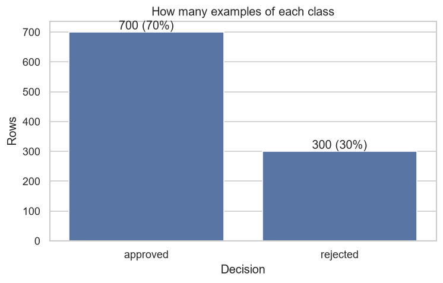

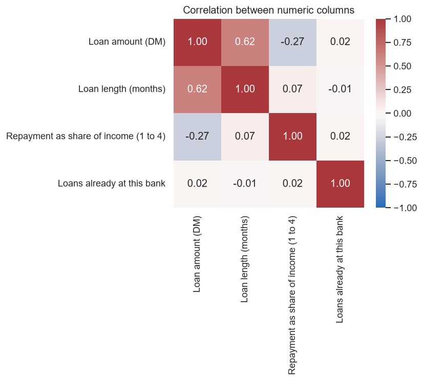
